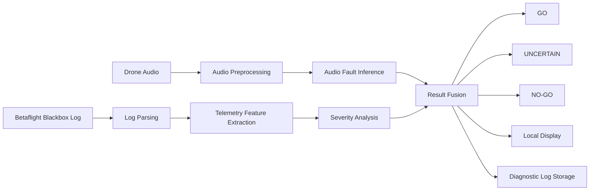
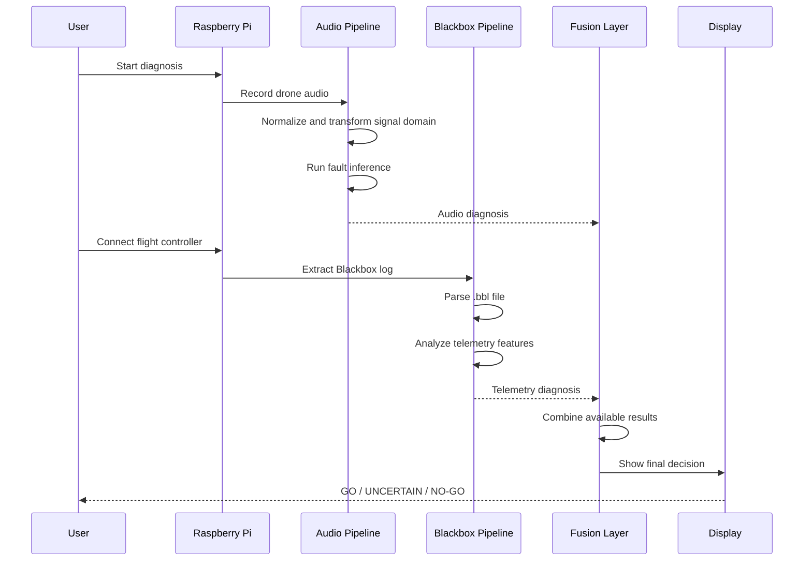

# Drone_audio_analysis
> A non-confidential technical summary of an end-to-end drone pre-flight health analysis system developed in a private team repository.

## Project Overview

Clover is a Raspberry Pi–based prototype for pre-flight drone health diagnosis.

The system combines two complementary sources of evidence:

1. Acoustic signals recorded from the drone.
2. Betaflight/Cleanflight Blackbox telemetry logs.

The outputs from these pipelines are combined into a unified diagnostic decision such as:

- `GO`
- `UNCERTAIN`
- `NO-GO`

The goal is to identify possible mechanical, motor, propeller, or control-related anomalies before flight.

The original implementation, trained models, operational datasets, and hardware-specific configuration remain in a private team repository. This repository contains only a non-confidential project overview, architecture documentation, synthetic examples, and simplified demonstration code.

## Why This Project Matters

Small drones can develop faults that are difficult to identify through visual inspection alone. Examples include:

- Propeller damage or imbalance;
- Motor performance degradation;
- Increased mechanical load;
- Abnormal vibration or acoustic signatures;
- Control-response inconsistencies;
- Unexpected current consumption.

Clover explores whether audio signals and flight-controller telemetry can be used together to provide an additional pre-flight health check.

## System Architecture



## End-to-End Workflow



## Main Analysis Pipelines

### 1. Audio Analysis

The audio pipeline processes a microphone recording of the drone.

The high-level flow is:

```text
Raw microphone recording
        |
        v
Audio normalization
        |
        v
Spectral signature transfer
        |
        v
Time-domain segmentation
        |
        v
Neural network inference
        |
        v
Hierarchical fault classification
```

The original system uses a PyTorch-based audio classifier with:

- A Gammatone-inspired front-end;
- One-dimensional convolutional layers;
- Residual blocks;
- Squeeze-and-Excitation components;
- Multi-level classification outputs;
- Optional fault-direction classification.

The model can produce results at multiple levels:

```json
{
  "binary": {
    "label": "anomaly",
    "confidence": 0.87
  },
  "semi": {
    "label": "motor",
    "confidence": 0.81
  },
  "detailed": {
    "label": "motor_fault_2",
    "confidence": 0.74
  }
}
```

The values above are synthetic examples and do not represent production results.

### 2. Blackbox Telemetry Analysis

The Blackbox pipeline processes flight-controller logs generated by Betaflight or Cleanflight.

The high-level flow is:

```text
.bbl flight log
        |
        v
Blackbox parser
        |
        v
CSV conversion
        |
        v
Arm/disarm flight segmentation
        |
        v
Telemetry feature extraction
        |
        v
Baseline-referenced severity scoring
```

The analysis considers features such as:

- Axis-error stability;
- Current per motor output;
- Motor balance;
- Command-to-motor consistency;
- Residual error between predicted and observed motor behavior.

The analysis compares test flights with healthy baseline data and produces a severity score.

Example:

```json
{
  "decision": "CAUTION",
  "severity_percent": 31.6,
  "features": {
    "axis_error": 0.42,
    "current_per_motor": 0.18,
    "io_residual": 0.27
  }
}
```

This is a synthetic example intended only to explain the output format.

### 3. Result Fusion

The fusion layer combines the available audio and Blackbox results.

A simplified policy is:

```text
If both analyses report GO:
    final result = GO

If either analysis reports NO-GO:
    final result = NO-GO

Otherwise:
    final result = UNCERTAIN
```

The system also supports partial operation:

- Audio-only diagnosis;
- Blackbox-only diagnosis;
- Both analyses;
- No completed analysis.

Example combined result:

```json
{
  "audio": {
    "decision": "GO",
    "fault": "normal"
  },
  "blackbox": {
    "decision": "CAUTION",
    "severity_percent": 27.4
  },
  "final_decision": "UNCERTAIN",
  "reason": "The audio pipeline reported normal behavior, while telemetry analysis indicated elevated severity."
}
```

## Raspberry Pi Deployment

The original prototype is designed to run on Raspberry Pi hardware.

The hardware-oriented runtime includes:

- Microphone input;
- ST7789 display;
- Physical buttons;
- USB connection to the flight controller;
- Local artifact storage;
- Optional background log synchronization.

The runtime workflow is designed to support:

- On-device recording;
- On-device inference;
- Offline result storage;
- Delayed synchronization when connectivity is available;
- Automatic startup through `systemd`.

The original implementation also addressed ARM-specific runtime issues by isolating audio transformation and neural-network inference into separate processes. This reduced conflicts between numerical libraries and CPU feature detection on Raspberry Pi hardware.

## Technology Stack

| Area | Technologies |
|---|---|
| Programming language | Python |
| Machine learning | PyTorch |
| Audio processing | NumPy, SciPy, librosa, SoundFile |
| Telemetry analysis | Pandas, NumPy, scikit-learn |
| Flight-controller logs | Betaflight/Cleanflight Blackbox, Orangebox-based parsing |
| Embedded hardware | Raspberry Pi, Adafruit Blinka, GPIO, ST7789 |
| Local API | FastAPI, Uvicorn |
| Remote synchronization | Supabase |
| Deployment | Raspberry Pi OS, virtual environment, systemd |

## Public Demonstration

This repository intentionally provides only synthetic examples.

Run the simplified fusion demonstration:

```bash
python examples/toy_result_fusion.py
```

Expected output:

```text
Audio decision: GO
Blackbox decision: CAUTION
Final decision: UNCERTAIN
```

The demonstration does not contain:

- The original trained model;
- Private training data;
- Real drone recordings;
- Real flight-controller logs;
- Production hardware configuration;
- Private infrastructure credentials;
- Internal team documentation.

## Repository Contents

```text
docs/          Non-confidential technical documentation
diagrams/      Architecture and workflow diagrams
examples/      Synthetic data and simplified demonstration code
screenshots/   Redacted or recreated visual examples
README.md      Project overview
CONTRIBUTIONS.md
               Personal contribution summary
LIMITATIONS.md Project limitations and exclusions
```

## Project Provenance

The original prototype was developed collaboratively in a private team repository.

This public repository was created to document the project's goals, architecture, engineering challenges, and selected high-level implementation ideas without redistributing confidential source code, datasets, model weights, or operational configuration.

The public summary is not the original implementation and should not be interpreted as a fully reproducible copy of the private system.

## My Contribution

My work on the project included:

- [Replace this line with your actual contribution.]
- [Replace this line with your actual contribution.]
- [Replace this line with your actual contribution.]

For an accurate description of responsibilities, please see [`CONTRIBUTIONS.md`](CONTRIBUTIONS.md).

## Limitations

This project is a research and engineering prototype rather than a certified aviation safety system.

The public repository does not provide:

- A complete production deployment;
- The original training pipeline;
- Production model checkpoints;
- Private datasets;
- Hardware calibration procedures;
- Verified safety guarantees.

The diagnostic output should be treated as an additional engineering signal, not as the sole basis for making flight-safety decisions.

## License

The documentation and synthetic examples in this repository are provided under the license in [`LICENSE`](LICENSE).

The license of the original private implementation and any third-party components remains subject to their respective agreements.
